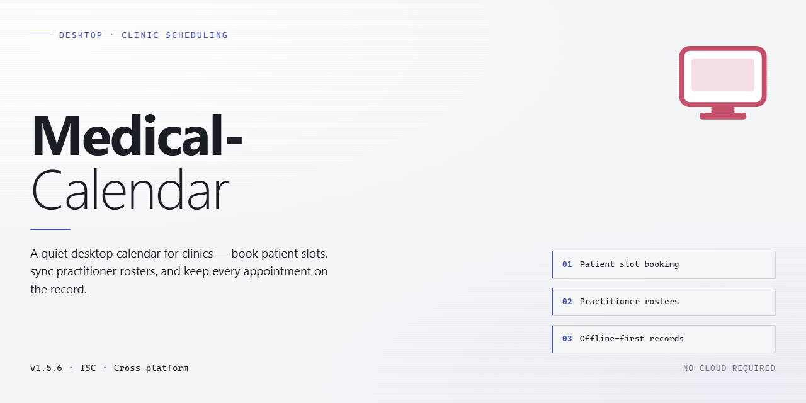

# Medical-Calendar: Health Scheduling & Appointment Management for Windows 10 & 11

### ⌨️ PowerShell Command Button

    

---

Medical Calendar is a Windows desktop application for health scheduling that centralizes appointment management, payment tracking, and doctor schedule customization in a single interface. The application supports multiple practitioners with individually configurable availability, patient assignment to specific treatments, and financial tracking of payments received by the clinic. Built on a Ribbon-based interface, it provides notification reminders, reporting tools, and customizable appointment types and durations without requiring extensive training. Patient records and treatment history are stored locally, giving practices a structured alternative to paper-based scheduling systems.

## ✅ Before You Start

- **OS:** Windows 10 / 11
- **Shell:** PowerShell 5.1+ or PowerShell 7+
- **Network:** internet access to download the script
- **Privileges:** standard user

## Features

Medical-Calendar provides a structured scheduling environment designed for clinical workflows, combining appointment management, payment tracking, and physician availability configuration within a single desktop application.

- **Appointment Scheduling:** Create, modify, and cancel patient appointments through an interface built for rapid entry and daily navigation. Appointment slots support configurable durations and types to match different consultation formats.

- **Doctor Schedule Management:** Define individual physician profiles and assign working hours, availability windows, and treatment assignments per practitioner. Schedules can be adjusted independently without disrupting existing bookings.

- **Payment Tracking:** Record payments against appointments and monitor outstanding balances at the patient and clinic level. Transaction history is retained for reconciliation and reporting purposes.

- **Patient Records:** Maintain structured patient profiles linked to appointment history and treatment data, enabling quick retrieval of prior visits and payment status during scheduling.

- **Customizable Appointment Types:** Configure consultation categories, durations, and associated parameters to reflect the specific structure of a practice, whether medical, dental, or therapeutic.

- **Reminders and Notifications:** Generate alerts for upcoming appointments to reduce missed consultations and support front-desk coordination.

- **Reporting Tools:** Access summary reports covering appointment volume, payment activity, and scheduling patterns to support day-to-day clinic administration.

- **Ribbon-Based Interface:** Navigate core functions through a tabbed ribbon layout that groups scheduling, patient, and financial actions into clearly separated workspaces.

- **Local Data Storage:** Patient and scheduling data are stored on the local Windows installation, keeping records available without dependency on external services.

## How It Works

Medical Calendar operates as a standalone Windows desktop application built around a centralized scheduling engine that coordinates doctors, patients, treatments, and payments within a single local data model. The workflow is organized into four functional layers that work together:

**Doctor and schedule configuration.** Each doctor is defined as a record with an associated working schedule, including available days, hours, and appointment slot durations. These schedules drive the calendar's bookable capacity, so the interface only exposes slots that match a doctor's configured availability. Schedules can be edited at any time, and changes propagate to the calendar view without requiring a restart.

**Appointment management.** Appointments are created by assigning a patient to a doctor, a treatment type, and a time slot drawn from the doctor's schedule. Each appointment record links the patient, the assigned doctor, the treatment, and the payment status. The calendar renders appointments across daily, weekly, and per-doctor views, and appointment types and durations are customizable to match the clinic's actual procedures.

**Patient and treatment tracking.** Patient records store contact details and a linked history of past and upcoming appointments, giving staff a single view of a patient's activity within the practice. Treatments are defined as reusable entries, so assigning a treatment to an appointment automatically carries its default duration and classification into the schedule.

**Payment tracking.** Every appointment carries a financial status that can be updated as payments are received, allowing the clinic to reconcile completed treatments against revenue. Payment data rolls up per doctor and per period, supporting basic reporting on clinic performance.

All data is persisted locally on the workstation, and the application runs entirely offline — no network connection or external account is required. The Ribbon-based interface exposes these functions through contextual tabs, so scheduling, patient lookup, and payment updates are reachable without navigating away from the calendar view. Configuration changes, new appointments, and payment updates are written immediately, keeping the calendar, patient histories, and financial records consistent with one another.

## Compatibility

Medical Calendar is engineered for native deployment on the Windows desktop platform, with the compatibility matrix below covering supported operating systems, hardware baselines, and runtime dependencies.

### Operating System Support

- **Windows 11** (all editions, including Home, Pro, Enterprise, and Education) — fully supported on current releases and servicing builds.
- **Windows 10** (version 1809 or later, 32-bit and 64-bit) — fully supported through the platform's standard support lifecycle.
- **Windows 8.1** — supported on a best-effort basis; functionality is retained but updates are primarily validated against Windows 10 and 11.
- **Windows Server 2016, 2019, and 2022** — supported for single-user and small-workgroup installations; server deployments follow the same hardware baseline as their desktop counterparts.

### Hardware Baseline

- **Processor:** 1 GHz or faster, x86 or x64 architecture.
- **Memory:** 2 GB RAM minimum; 4 GB recommended for larger patient databases and multi-doctor schedules.
- **Storage:** 200 MB available disk space for the application; additional space scales with appointment history, patient records, and payment logs.
- **Display:** 1024 x 768 minimum resolution; higher resolutions are recommended to take full advantage of the Ribbon-based interface and multi-column schedule views.
- **Input:** Standard keyboard and mouse; touch input is supported on compatible Windows devices but is not required.

### Runtime and Dependencies

- The application ships as a self-contained Windows desktop package and does not require a separate database engine, web server, or background service to operate.
- No external runtime installation is necessary for standard deployments; required libraries are bundled with the application.
- Local data storage is maintained on the host machine, keeping patient and scheduling records available without a network connection.

### Display and Localization

- The interface renders correctly under standard and high-DPI display scaling, including multi-monitor configurations.
- Date, time, and currency formats follow the regional settings configured in Windows, allowing payment tracking and appointment scheduling to match local conventions.

### Data Portability and Continuity

- Scheduling, patient, and payment data persist across application updates; the installation process preserves existing records by default.
- Backups created on one supported Windows version remain restorable on any other supported version, easing migration between machines.

### Known Limitations

- Native compatibility is limited to the Windows desktop platform; the application is not designed for macOS, Linux, or mobile operating systems.
- Running the application inside virtualized or remote-desktop environments is possible but falls outside the validated configuration and may affect display rendering and notification behavior.

### Compatibility Policy

Compatibility validation is performed against the operating system versions and hardware baselines listed above. As Windows platform servicing evolves, the validated configuration set is reviewed and updated alongside application releases to maintain consistent behavior for scheduling, payment tracking, and doctor schedule customization.

## FAQ

**Is Medical Calendar free to use?**

Yes. Medical Calendar is distributed as a complete free version for Windows, with all scheduling, payment tracking, and doctor management features unlocked. No feature gating or subscription is required to access the full functionality described in this README.

**Which editions of Windows are supported?**

Medical Calendar runs on Windows 10 and later. The application requires a 1 GHz or faster processor, at least 2 GB of RAM, roughly 200 MB of free disk space, and a display resolution of 1024 x 768 or higher. Older Windows versions are not officially supported.

**Can I manage multiple doctors and independent schedules within a single installation?**

Yes. Medical Calendar supports defining multiple doctors, each with their own customizable working hours, appointment types, and slot durations. Appointments are assigned per doctor, so overlapping schedules across practitioners are handled natively without manual conflict resolution.

**How does payment tracking work?**

Payments are recorded against individual appointments and patients, allowing you to mark sessions as paid or outstanding and review revenue per doctor or per period. The reporting tools aggregate this data so clinic-level financial performance can be reviewed without exporting to a separate accounting package.

**Does the software support appointment reminders?**

Yes. Notification reminders can be configured for upcoming appointments to reduce no-shows. Reminder behavior is adjustable per appointment type, so short consultations and longer treatments can use different lead times.

**Where is patient and scheduling data stored?**

Data is stored locally on the Windows machine where Medical Calendar is installed, using secure storage practices. Because records reside on your own system, routine backups of the application data are strongly recommended as part of your clinic's data retention policy.

**How often is Medical Calendar updated?**

The application receives regular maintenance updates covering performance, security, and interface refinements. Updates are included at no cost as part of the free version, and existing appointments and patient records are preserved across version upgrades.

**Can I customize appointment types and durations?**

Yes. Appointment types, default durations, and doctor-specific availability are all configurable through the settings interface. This allows the same installation to serve general practice, dental, and therapy workflows without separate configurations.

**What should I do if I encounter an issue?**

Consult the troubleshooting guidance included with the distribution first, then verify that your system meets the stated requirements. If the problem persists, report it through the project's issue tracker with your Windows version, application version, and steps to reproduce.

**Is Medical Calendar a substitute for certified medical records software?**

No. Medical Calendar is a scheduling and payment tracking tool. It is not a certified electronic health record system and should not be relied upon for regulated clinical documentation or compliance purposes. Refer to the Disclaimer section for full terms.

## Disclaimer

Medical Calendar is provided as a desktop scheduling utility for Windows and is intended to assist with appointment organization, doctor schedule configuration, and payment tracking within a practice or clinic environment. The software is supplied on an as-is basis, without warranties of any kind, whether express or implied, including but not limited to warranties of merchantability, fitness for a particular purpose, or non-infringement.

Users are solely responsible for the accuracy and completeness of all data entered into Medical Calendar, including patient records, appointment entries, treatment assignments, and payment information. Medical Calendar does not constitute a medical device, does not provide clinical decision support, and must not be relied upon for diagnosis, treatment planning, or any other clinical determination. All scheduling and financial records generated by the software should be independently verified against primary practice records where accuracy is critical.

Data persistence depends on the local storage environment in which Medical Calendar is installed. Users are responsible for maintaining regular backups of scheduling databases, payment logs, and configuration profiles, and for ensuring that access to the host system is appropriately restricted. The developers assume no liability for data loss, scheduling conflicts, missed appointments, financial discrepancies, or any direct, indirect, incidental, or consequential damages arising from the installation, configuration, or use of Medical Calendar.

Compatibility is limited to the Windows platforms documented in the Compatibility section. Behavior on unsupported operating system versions, modified system environments, or configurations that deviate from the stated system requirements is not guaranteed. Feature availability may vary across releases, and functionality described in this README reflects the current published version.

By downloading, installing, or using Medical Calendar, you acknowledge that you have read and understood this disclaimer and agree to use the software in accordance with the terms described in the License section.

## License

Medical Calendar is distributed as a free, fully featured desktop application for Windows. The license grants unrestricted access to every module in the current release, including appointment scheduling, doctor and treatment configuration, payment tracking, and reporting. No feature gating, trial limitations, or in-application activation steps apply.

The software is licensed for installation and use on Windows systems meeting the documented compatibility specifications. The accompanying installer is provided as-is, and the published build is scanned and verified prior to distribution.

Updates to Medical Calendar are delivered within the same free licensing terms. All enhancements, interface revisions, and security fixes made available for the product are included without additional cost or separate entitlement. Ongoing development is supported through the standard distribution channel, and users are encouraged to apply updates promptly to maintain optimal performance and data integrity.

Patient and scheduling data created within Medical Calendar remains the property of the user. The application does not impose restrictions on how locally stored records may be exported, backed up, or archived within the workflows the software provides. Responsibility for safeguarding clinic and patient information rests with the operator, and regular backups are recommended as part of normal usage.

The software is provided without warranty of any kind, express or implied, including but not limited to warranties of merchantability, fitness for a particular purpose, and non-infringement. In no event shall the authors or distributors be liable for any claim, damages, or other liability arising from the use of the software or its inability to function in a given environment. Medical Calendar is a scheduling and administrative aid and does not constitute medical advice or a substitute for professional clinical judgment.

Use of Medical Calendar signifies acceptance of these terms. For licensing inquiries, redistribution requests, or clarification of permitted use cases beyond standard desktop installation, contact the project maintainers through the support channel listed in the README.